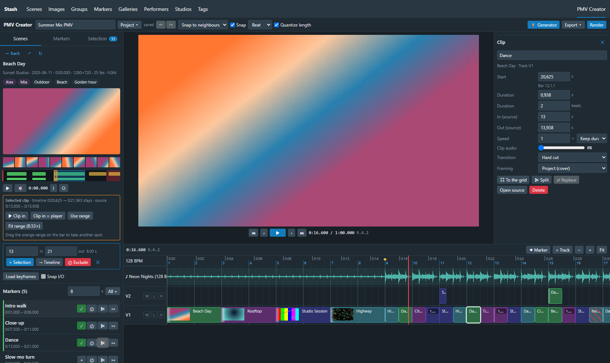

# Stash plugins (PepegaSan)

Community plugins for [Stash](https://github.com/stashapp/stash), installable via [source URL](#installation-from-stash-plugin-source-url) or manual copy from `plugins/<id>/`.

**Jump to:** [Folder Sidebar](#folder-sidebar) · [Quick Markers](#quick-markers) · [Bracket Tags](#bracket-tags) · [Tag Performers](#tag-performers) · [Tag Categories](#tag-categories) · [PMV Creator](#pmv-creator)

| Plugin | Description |
|--------|-------------|
| [Folder Sidebar](#folder-sidebar) | Browse scenes by filesystem folder |
| [Quick Markers](#quick-markers) | Hotkey scene markers with presets |
| [Bracket Tags](#bracket-tags) | Tags from `[brackets]` in filenames |
| [Tag Performers](#tag-performers) | Add performers to scenes that have a tag with their name |
| [Tag Categories](#tag-categories) | Browse scenes by named categories (any matching tag or performer) |
| [PMV Creator](#pmv-creator) | Deterministic PMV editor: beat grid, generator, FFmpeg render, EDL/OTIO export |

---

# Folder Sidebar

Fixed sidebar with your own root folders, drill into subfolders, and list scenes in the current directory only — no filter UI.


## Features

- **Folder** entry in the main navigation (with icon)
- Configurable **root folders** (sidebar + settings UI)
- **Subfolders** per root, breadcrumb navigation, **up one level**
- **Files in this folder** only (not recursive into subfolders)
- **Browse cache** — reopening a folder or using the browser **Back** button after opening a scene shows the last list immediately (background refresh optional)
- Settings UI: add folders (label + path), **Delete** per row, collapsible sections, optional JSON editor

## Requirements

- Stash with UI plugin support (recent stable builds)
- Scenes indexed under the paths you configure

## Installation

### From Stash (plugin source URL) {#installation-from-stash-plugin-source-url}

1. In Stash: **Settings → Plugins → Available Plugins**
2. Add this **source URL** (after [GitHub Pages](#github-pages-one-time) is enabled on the repo):

   ```
   https://pepegasan.github.io/Stash-Folder-Sidebar-Plugin/main/index.yml
   ```

3. Install **Folder Sidebar**, **Quick Markers**, **Bracket Tags**, **Tag Performers**, and/or **Tag Categories** from the list, then reload plugins if prompted.

### Manual

1. Download or clone this repository.
2. Copy everything from **`plugins/folderSidebar/`** into your Stash plugins directory as **`folderSidebar`**:

   | OS | Path |
   |----|------|
   | Windows | `%USERPROFILE%\.stash\plugins\folderSidebar\` |
   | Linux / macOS | `~/.stash/plugins/folderSidebar/` |

   Required files in that folder:

   - `folderSidebar.yml`
   - `folderSidebar.js`
   - `folderSidebar.css`
   - `folders.json` (copy from `folders.json.example`)

3. In Stash: **Settings → Plugins → Reload plugins**
4. Enable **Folder Sidebar** if needed
5. Configure folders (see below)

### Git clone (example)

```bash
git clone https://github.com/PepegaSan/Stash-Folder-Sidebar-Plugin.git
cp -r Stash-Folder-Sidebar-Plugin/plugins/folderSidebar ~/.stash/plugins/folderSidebar
cp ~/.stash/plugins/folderSidebar/folders.json.example ~/.stash/plugins/folderSidebar/folders.json
```

Then reload plugins in Stash.

## GitHub Pages (one-time)

For the source URL above to work, enable Pages on this repository:

1. GitHub repo → **Settings → Pages**
2. **Build and deployment → Source:** GitHub Actions
3. Push to `main` (or run the **Deploy repository to GitHub Pages** workflow manually)

The workflow builds `index.yml` and plugin zips from `plugins/` using `build_site.sh` (same pattern as [stashapp/plugins-repo-template](https://github.com/stashapp/plugins-repo-template)).

## Configuration

### Settings UI (recommended)

**Settings → Plugins → Folder Sidebar**

- **Root folders** — list of configured entries (collapsible)
- **Add folder** — **Label** + **Path**, then **Add** (use normal paths: `D:\Media\AMV`, not JSON escaping)
- **Delete** — removes a row (with confirmation)
- **Edit JSON (advanced)** — bulk edit; in JSON files use `\\` for backslashes

After you add a folder in the UI, settings are stored in Stash and override `folders.json`.

### `folders.json` (optional file)

Copy `folders.json.example` to `folders.json` and edit:

```json
[
  { "label": "Project A", "path": "/data/Special/ProjectA" },
  { "label": "NAS PMV", "path": "\\\\NAS\\Videos\\PMV" }
]
```

- **`label`**: Name in the sidebar  
- **`path`**: Exact path as shown in Stash **File info** for a scene in that tree  
- In **JSON only**: double backslashes on Windows (`D:\\Media\\...`)

## Usage

- Click **Folder** in the top navigation  
- Left: root folders from config  
- Pick a subfolder or view files in the current folder  
- Direct link (same Stash session): `http://localhost:9999/plugin/folder-sidebar`  
  - Opening in a **new tab** or refresh may show **404** — [known Stash plugin route limitation](https://github.com/stashapp/stash/issues/4510)

## Performance and cache

- The first time you open a folder, Stash loads all scenes under that path (can take a while on large trees).
- **v1.4.1+** keeps results in memory for **30 minutes** per folder path. After you open a scene and go **Back**, the folder view appears right away from cache; Stash may still refresh in the background (**Updating…** next to **Refresh**).
- Use **Refresh** to force a reload (clears cache for the current folder).
- For faster first loads, use **smaller root folders** in settings instead of one huge library path.

## Notes

- **Scenes only** (not images/galleries)  
- Paths must match Stash’s indexed paths (Docker: often `/data/...`, not `D:\...`)  
- Very large folders load all scenes at once on first visit; split roots if needed  

---

# Quick Markers

Create **scene markers** from the scene player with **presets** (e.g. tag `Compilation`) — no marker dialog.


## Requirements

- Stash UI plugins enabled
- **Tags must exist** in Stash before use (e.g. create tag `Compilation` under **Tags**)
- Copy `presets.json.example` → `presets.json` in the plugin folder, or configure under **Settings → Plugins → Quick Markers**

## Hotkeys (defaults)

| Key | Action |
|-----|--------|
| `shift+1` … `shift+9` | **Select** the preset assigned to that slot (`selectSlot` in settings — not always list order) |
| `shift+i` | **In** point (active preset) |
| `shift+o` | **Out** + create range marker (active preset) |
| `shift+m` | Instant marker at playhead (**active** preset; Shift+M, not Ctrl+M) |
| `shift+[` / `shift+]` | Previous / next active preset |

**Note:** Plain `i` / `o` / `m` are used by Stash. `shift+m` is free in Stash and browsers. Assign up to nine presets to Shift+1–9 via **Select hotkey** when editing a preset (useful if you have more than nine).

## Usage

1. Open a **scene** and start playback.
2. Press **Shift+3** (etc.) to select the preset assigned to that slot, **or** click it in the panel.
3. Use **Shift+I** at start, **Shift+O** at end → range marker with that preset’s tag.
4. Or press **Shift+M** for an instant marker at the current time (active preset).
5. Optional: floating **Quick Markers** panel (corner in settings; collapsed by default) — **In / Out / + Instant** buttons, preset chips with their `⇧1–9` slot, and a red recording badge with the in time (also when collapsed; **×** discards the in point). **Drag the header** to move it, double-click header to reset; `Shift+[` / `Shift+]` also cycle presets.
6. **Android / tablet:** touch bar (**IN** / **OUT** / **INSTANT** + presets) directly under the video, part of the page — never on top of the player, so the seek bar and player settings stay reachable; the video gets a little smaller instead. One compact row on low screens (phone in landscape), **×** discards the in point. Use **Hide** / **▲ Quick Markers** to collapse or expand; remembered across scenes. Auto-enabled on touch devices; override in settings.

Markers are saved via GraphQL; open the **Markers** tab or refresh if the list does not update immediately.

## Copy markers to other scenes

For videos that exist more than once (re-encodes, renamed copies) — in the expanded scene panel (classic) or the **Quick Markers** section of the Stash UI player:

- **Copy** — takes all markers of the scene (times, titles, primary tag, tags)
- **Paste** — pastes them into the scene you are on. Shows a preview first; markers that are already there (same tag, start and end within 0.5 s) are skipped. **Shift (seconds)** moves all markers, for a copy that starts earlier or later; markers that would start before 0 or after the end are left out, ends are cut at the end of the video. Copy and paste also work across classic Stash and Stash UI
- **Same videos** — finds scenes with the same video fingerprint (phash, at most 4 of 64 bits different) and almost the same length (within 3 s). It shows them with a thumbnail (click opens the scene in a new tab), path, length and markers next to the current scene, ticks only those within 1 s that are not short clips (under 30 s — those are flagged *short clip — check*), and copies the markers there with one click. **Take** copies the markers of one of them into the current scene instead
- **Undo** — removes the markers of the last paste / transfer again (button in the panel, in Stash UI also in the message); kept for a day, also across classic Stash and Stash UI
- **Only these markers** — *Paste*, *Same videos* and *Marker Sync* show the marker names as chips in alphabetical order (with in how many videos each is; hover for the number of markers). *All* is on by default; click a name (e.g. `Party`) to transfer only markers with that name, click more names to add them. The name is what Stash shows: the marker's title, or its primary tag when it has no title

**Marker Sync** (whole library) — a page of its own: **Marker Sync** in the classic navigation, **Manage → Marker-Abgleich / Marker sync** in Stash UI, or *All same videos of the library* in the Same videos dialog. It lists every group of same videos (Stash's duplicate search over the phashes, at most 4 of 64 bits apart, length within 3 s) as cards with thumbnail, path, length and markers. The video with the most markers is preselected as **source**; the **Source** radio on every card picks another (e.g. a video you marked by hand). The other videos then get exactly the source's markers: markers they have that the source lacks are **deleted** — unless **keep its markers** is ticked on that card (off by default), then the source's markers are only added. Groups whose markers differ come first (*Markers differ* / *All groups*). Copy per group or **All ticked** at once — preselected are videos within 1 s, no short clips, that would lose no markers. **Undo** removes the copied markers and restores deleted ones. **Show groups with** a marker name (e.g. `Party`) lists only groups where a video has such a marker. **Transfer** then decides what is copied: **only Party** (default) or **all markers** — e.g. to give the `Party` video the markers of the others, pick *all markers* and the other video as source. With *only Party*, replacing works as without a filter — a video then has exactly the source's `Party` markers and nothing else. Tick **keep markers with other names** to replace only the `Party` markers and leave all others (e.g. `schlafen`) as they are; then a video *without* `Party` can be the source too, to delete wrongly set `Party` markers in the others (without that tick such a source is locked, it would delete all their markers). To clean up the source as well, tick **only keep the chosen markers** on the source card (shown with a name filter, without *keep markers with other names*): its markers with other names are deleted too, so every video of the group ends up with only `Party`. It is never preselected; *Undo* restores them. Groups with a **short clip** (under 30 s) are flagged and always come last. **✓ Tick off** on a group hides it (also *Tick off short clips* for all of them at once); the tab **Ticked off** lists them, **↺ Restore** brings one back. Ticked-off groups are kept in this browser (classic Stash and Stash UI share them); a group that gets another video counts as new.

*Same videos* and *Marker Sync* need phashes: **Tasks → Generate → Phashes** (or the button in the dialog, which starts that task for scenes without one). Byte-identical files are already one scene in Stash and share their markers anyway.

## Stash UI

With the [Stash UI](https://github.com/AffordObedienceUntamed/stash-pmv-plugins) plugin (alternative interface, extension API v2), Quick Markers loads `stashui.js` from this plugin automatically — nothing to configure:

- **Player info bar → Quick Markers** — In / Out / Instant buttons, preset chips, live range while recording (`0:12 → 0:30`); the markers list and timeline pins refresh after each marker
- **Same hotkeys** as in classic Stash. They are caught before the Stash UI player, so `Shift+I` / `Shift+O` / `Shift+M` no longer also fold the info bar, add an O or mute. Plain `I` / `O` / `M` keep their player function. Shift+1–9 works on any keyboard layout
- **Missing tag** — the error message has a **Create tag** button and then saves the marker
- **Settings → Plugins → Quick Markers** — the same settings page as in classic Stash (see [Configuration](#configuration)), in Stash UI's look; same storage (`presetsJson`)
- Follows Stash UI's colour presets, liquid glass and interface language (English / German)

The classic panel and touch bar also pick up the Stash UI colours when Stash UI restyles classic Stash.

## Configuration

**Settings → Plugins → Quick Markers**

One page for classic Stash and Stash UI (`settings.js`), in English or German:

- **General** (classic Stash only) — **panel position** (corner or hidden, drag the panel header to place it freely), **start collapsed**, **touch controls** (auto / on / off)
- **Presets** — every preset with its select key, tags as chips (primary tag highlighted) and its In / Out / Instant keys
  - **★** marks the **default preset** (active when a scene opens) — click another star to change it
  - Tags missing in Stash are red; the **+** on such a chip creates the tag (**Create all** in the warning above the list)
  - **Duplicate** a preset to use it as a template (the copy opens right away, without a select key)
  - **Drag the handle** (or ↑ / ↓ on it) to change the order — it is the order of the preset chips on the scene page; at the top or bottom edge the page scrolls along
  - From 8 presets on, a **search field** filters by name and tag
- **Edit / New preset** — opens right under the row: name, **primary tag** and **more tags** with suggestions from Stash (number of scenes each), **select key** Shift+1–9 as buttons (taken ones struck through; taking one moves it), **key fields** that record the combination you press, with warnings for clashes (same key twice, Shift+1–9, plain keys). Duplicate and Delete are here too (on phones only here)
- **Advanced** — help and the full config as JSON

JSON example:

```json
{
  "defaultPresetIndex": 0,
  "panelPosition": "top-left",
  "panelCollapsed": true,
  "touchControls": "auto",
  "presets": [
    {
      "id": "compilation",
      "label": "Compilation",
      "primaryTag": "Compilation",
      "tags": ["Favorite"],
      "title": "Compilation",
      "rangeInKey": "shift+i",
      "rangeOutKey": "shift+o",
      "instantKey": "shift+m",
      "selectSlot": 1
    }
  ]
}
```

- `primaryTag` — exact tag **name** in Stash (required); becomes the marker **primary tag**
- `tags` — optional array of extra tag names on the marker (must exist in Stash)
- `rangeInKey` / `rangeOutKey` — range workflow for that preset when it is **active** (defaults to `shift+i` / `shift+o` if omitted)
- `instantKey` — instant marker for the **active** preset (defaults to `shift+m`)
- `selectSlot` — `1`–`9` maps this preset to `shift+1`–`shift+9`; `null` = no select hotkey (defaults: first nine presets get slots 1–9)
- `panelPosition`, `panelCollapsed`, `touchControls` — optional UI settings

Presets are stored in **Stash plugin settings** (`presetsJson`) after you save in the UI. The optional `presets.json` file in the plugin folder is only used until settings are saved once.

## Manual install

Copy `plugins/quickMarkers/` to `~/.stash/plugins/quickMarkers/`, add `presets.json` from the example, then reload (see below).

### Reload plugins in Stash (important)

`Ctrl+F5` alone is **not** enough — Stash loads plugin JavaScript separately from the main UI bundle.

1. Replace files under `~/.stash/plugins/quickMarkers/` (all of them).
2. **Settings → Plugins → Reload plugins** (wait until it finishes).
3. Click **Reload UI** on the plugin row (or fully close the browser tab and open Stash again).
4. Optional (Docker): restart the Stash container.
5. Verify: open browser **F12 → Console** — you should see `[Quick Markers] loaded v1.13.1`.
6. Open **Settings → Plugins → Quick Markers** — the heading must show **v1.13.1** next to Quick Markers.

If an old version number appears, the old plugin files are still active.

---

# Bracket Tags

Adds **scene tags** from text in **square brackets** in the filename — e.g. `[Joi]` and `[Talk]` in `My Clip [Joi] [Talk].mp4`. Simpler than generic filename parsers: no regex config, just run a task or enable auto-tagging on scan.


## Features

- Reads every `[...]` block from the scene filename (first file on the scene)
- **Multiple brackets** — `[Tag A] [Tag B]` or comma-separated inside one bracket: `[Tag A, Tag B]`
- **Innermost brackets only** — an unclosed `[` in the name is ignored: `Clip [1 [Solo].mp4` gives `Solo`
- **Create missing tags** — optional; on by default (no manual tag setup required)
- **Two tasks** — **Add** (only adds tags, never removes) and **Sync** (adds and removes stale bracket tags)
- **Auto on new scenes** — optional hook after library scan (new scenes only)
- Skips **organized** scenes and scenes without any `[...]` in the filename
- **Stale bracket tags** — when a `[bracket]` disappears from the filename (e.g. after a rename), the **Sync** task removes its tag from the scene. **Add** keeps it, so you can update first and clean up later

## Requirements

- Stash with plugin task support (recent stable builds)
- **Scenes only** (not images/galleries)

## Installation

Install from the [plugin source URL](#installation-from-stash-plugin-source-url) (**Bracket Tags** in the list), or copy manually:

| OS | Path |
|----|------|
| Windows | `%USERPROFILE%\.stash\plugins\bracketTags\` |
| Linux / macOS | `~/.stash/plugins/bracketTags/` |

Required files: `bracketTags.yml`, `bracketTags.js`

Then **Settings → Plugins → Reload plugins**.

## Configuration

**Settings → Plugins → Bracket Tags**

| Setting | Default | Description |
|---------|---------|-------------|
| **Create missing tags** | on | Create tags in Stash when the bracket name does not exist yet |
| **Auto on new scenes** | off | Add bracket tags automatically when a scene is created (e.g. after scan). Only adds, never removes |

Every tag the plugin sets is grouped under the parent tag **Bracket Tags**, so the Sync task knows which tags it manages.
Sync also removes a manually added tag that has the same name as a bracket tag.

Up to 1.1.0 there was a setting **Remove stale bracket tags**. Since 1.2.0 removing is a separate task instead; an old
stored value of that setting is ignored.

## Usage

### Existing library

| Task | What it does |
|------|--------------|
| **Add bracket tags to all scenes** | Adds tags from `[brackets]` to every scene. Existing tags are never removed, also not old bracket tags after a rename |
| **Sync bracket tags (add + remove stale)** | Adds, and removes bracket tags whose `[bracket]` is no longer in the filename. Also cleans up broken tags such as `1 [Solo` from versions before 1.2.1 (removed from scenes, deleted when no longer used) |

Typical after renaming files: run **Add** first (new tags appear, old ones stay), check in Stash, then **Sync** to
remove the old ones. Progress and every changed scene are shown in the task log.

### New files after scan

Enable **Auto on new scenes** in plugin settings, then run a normal library scan. Each new scene gets bracket tags from its filename without running the task again.

### Examples

| Filename | Tags added |
|----------|------------|
| `My Clip [Joi] [Talk].mp4` | `Joi`, `Talk` |
| `Clip [Joi, Talk].mp4` | `Joi`, `Talk` |
| `No brackets here.mp4` | *(skipped)* |

## Notes

- Matching is **case-insensitive** when checking if a tag already exists on the scene
- Tag **names** in brackets are used as-is (trimmed); create-missing uses the exact bracket text
- Re-running either task is safe — already-applied tags are not duplicated
- Organized scenes and scenes without any `[...]` are never changed, by neither task
- For complex filename layouts (studio/date/performer patterns), use Stash’s built-in **Scene Filename Parser** instead

## Manual install

```bash
git clone https://github.com/PepegaSan/Stash-Folder-Sidebar-Plugin.git
cp -r Stash-Folder-Sidebar-Plugin/plugins/bracketTags ~/.stash/plugins/bracketTags
```

Reload plugins in Stash, then run the task or enable **Auto on new scenes**.

---

# Tag Performers

Many scenes carry the model name as a **tag** (for example from a `[bracket]` via [Bracket Tags](#bracket-tags)). Tag
Performers adds the matching **performer** to those scenes: create the performer "Anna" and every scene with the tag
"Anna" gets her as performer.


## Features

- **Auto on new performers** — optional hook: a newly created performer is added to all scenes with a tag of the same name
- **Task for the whole library** — checks every existing performer once
- Matches the performer's **name and aliases** against tag **names and aliases**; exact match, case-insensitive, never partial
- Only the tag itself counts, not its sub-tags
- Performers are **only added**, never removed; other performers and tags on the scene stay as they are
- **Remove the matching tag** — optional, off by default: the tag with the performer's name is removed from those scenes

## Installation

Install from the [plugin source URL](#installation-from-stash-plugin-source-url) (**Tag Performers** in the list), or copy manually:

| OS | Path |
|----|------|
| Windows | `%USERPROFILE%\.stash\plugins\tagPerformers\` |
| Linux / macOS | `~/.stash/plugins/tagPerformers/` |

Required files: `tagPerformers.yml`, `tagPerformers.js`

Then **Settings → Plugins → Reload plugins**.

## Configuration

**Settings → Plugins → Tag Performers**

| Setting | Default | Description |
|---------|---------|-------------|
| **Auto on new performers** | off | When a performer is created, add it to every scene with a tag of the same name or alias |
| **Remove the matching tag** | off | After adding the performer, remove the matching tag from those scenes |

## Usage

| How | What it does |
|-----|--------------|
| **Auto on new performers** (setting) | Create a performer in Stash, its tagged scenes get it right away |
| **Add performers to tagged scenes** (task) | Goes through all performers; use it once for existing performers and after a scan that brought new tagged scenes |

Every changed performer and the number of scenes are shown in the task log.

## Notes

- The hook only runs when a performer is **created**. Scenes that get the tag later (new files, Bracket Tags on scan)
  get the performer the next time you run the task
- With **Remove the matching tag** on, Bracket Tags adds the tag again on its next run as long as the `[name]` is
  still in the filename
- If two performers share an alias that is also a tag, scenes with that tag get both

## Manual install

```bash
git clone https://github.com/PepegaSan/Stash-Folder-Sidebar-Plugin.git
cp -r Stash-Folder-Sidebar-Plugin/plugins/tagPerformers ~/.stash/plugins/tagPerformers
```

Reload plugins in Stash, then run the task or enable **Auto on new performers**.

---

# Tag Categories

Named **categories**, each with a list of Stash **tags** and optionally **performers**. Open **Categories** in the main menu, pick a category, and browse every scene that has **any** of those tags or performers (OR filter). Categories live in plugin settings — they are not a native Stash entity.

The same tag can appear in multiple categories; categories do not block or claim tags from each other.


## Features

- **Categories** item in the main navigation, with the **number of scenes** next to each category
- Click a category → scenes matching **any** of its tags
- **Sub-tags** — optionally a category includes all child tags of its tags (Stash tag hierarchy, any depth). A parent
  tag such as **Bracket Tags** becomes a category on its own, and new child tags show up automatically
- **Tag chips** — narrow a category down: click = select (pink, ✓), right-click = exclude (red outline, ✕, struck
  through), **Any of them / All** for several selected tags. While something is chosen, the untouched chips fade.
  Each chip shows its number of scenes
- **Main tag (★)** — like the main tags of the PMV Generator: ★ on a chip (or Shift+click) makes it the main tag.
  Every scene then has it, and the other chips only show what goes with it, counted within its scenes — e.g. main tag
  *Model X* shows *Model X* with action *Z, A, D* and how many scenes each. Click it again to take it back; it is
  optional, without ★ everything works as before
- **Performers** — a category can also list performers (e.g. *Performer X* with action *F*): they get a chip row of
  their own (click, right-click, ★ as main performer) and their scenes belong to the category too
- **Loads page by page** — 60 scenes at a time, more while scrolling (or **Load more**), so large categories open fast
- **Search** and **Sort** (title, duration, date) run on the Stash server, over the whole category
- **Open in Stash** — the same selection (tags, excluded tags, search, sort) as a regular Stash scene list, with
  paging, bulk edit and queue
- **List / Preview** view toggle (thumbnails in Preview; preference kept in the browser)
- Settings page (classic Stash and Stash UI): categories with their number of scenes (opens the category page), drag to reorder, duplicate, search, missing tags / performers created with one click, editor right under the row with tag and performer suggestions from Stash, **Include sub-tags** switch and a live preview of the matching scenes
- **Advanced**: help and the full config as JSON
- UI language follows Stash (**English** / **German**; otherwise English)

## Requirements

- Stash with UI plugin support (recent stable builds)

## Installation

Install **Tag Categories** from the [plugin source URL](#installation-from-stash-plugin-source-url), or copy manually:

| OS | Path |
|----|------|
| Windows | `%USERPROFILE%\.stash\plugins\tagCategories\` |
| Linux / macOS | `~/.stash/plugins/tagCategories/` |

Required files: `tagCategories.yml`, `tagCategories.js`, `tagCategories.css`, `settings.js`, `settings.css` (Stash UI: also `stashui.js`, `stashui.css`)  
Optional: `categories.json` (copy from `categories.json.example`)

Then **Settings → Plugins → Reload plugins**.

## Configuration

**Settings → Plugins → Tag Categories**

One page for classic Stash and Stash UI (`settings.js`):

| Part | Description |
|------|-------------|
| **Categories** | Each category with its number of scenes (a click opens the category page) and its tags / performers as chips. Missing in Stash: red, the **+** on the chip creates the tag or performer (**Create all** in the warning). **Duplicate** a category as a template. Drag the handle (or ↑ / ↓ on it) to change the order of the category menu; the page scrolls along at the edge. From 8 categories on, a **search field** filters by name, tag and performer |
| **Edit / New category** | Opens under the row: name, tags and performers with suggestions from Stash, **Include sub-tags**, live preview of how many scenes match; Duplicate and Delete (on phones only here) |
| **Advanced** | Help and the full config as JSON |

### JSON shape

```json
{
  "categories": [
    {
      "id": "genre",
      "name": "Genre",
      "tags": ["Action", "Comedy", "Drama"]
    },
    {
      "name": "Bracket Tags",
      "tags": ["Bracket Tags"],
      "subTags": true
    },
    {
      "name": "Models",
      "tags": ["Dance", "Outdoor"],
      "performers": ["Jane Doe", "John Doe"]
    }
  ]
}
```

| Field | Role |
|-------|------|
| `name` | Label in the UI |
| `tags` | Tag names to filter by (any match) |
| `performers` | Performer names (or an alias) — their scenes count too, each gets a chip (optional) |
| `subTags` | `true` = child tags of these tags count too, any depth (optional) |
| `id` | Fixed browser URL (optional; otherwise from `name`) |

Saved in plugin settings (`categoriesJson`) after you save in the UI. An optional `categories.json` in the plugin folder is used only until settings are saved once.

## Usage

1. Add categories under **Settings → Plugins → Tag Categories**
2. Open **Categories** in the main menu
3. Select a category in the left sidebar — matching scenes appear on the right
4. Narrow it down with the **tag chips**: click to select, right-click to exclude; with several selected tags choose
   **Any of them** or **All**. **★** (or Shift+click) makes a chip the main tag: only what goes with it is left, with
   its numbers. **Reset** clears the selection
5. Switch **List** / **Preview** above the results; more scenes load while you scroll
6. Use the search box and **Sort** for title, duration, or date
7. **Open in Stash** shows the same selection in the regular scene list. Stash's list can't combine tags *or*
   performers with *Any of them*, nor a main tag with *Any of* more tags — then the button is greyed out

## Stash UI

With the [Stash UI](https://github.com/AffordObedienceUntamed/stash-pmv-plugins) plugin (alternative interface, extension API v2), Tag Categories loads `stashui.js` from this plugin automatically — nothing to configure. Before, its menu entry opened the page in embedded classic Stash; now it is a page of Stash UI itself:

- **Library → Categories** in the left menu, right after Tags (movable and hideable in Customize → Sidebar)
- The same page as in classic Stash: categories with their number of scenes, tag and performer chips (click / right-click / ★ main tag, *Any of them* / *All*), search, sort, **List / Preview** (the preview plays on hover), more scenes while scrolling
- A click on a scene opens the **Stash UI player**; **Open in classic Stash** shows the same selection as a regular scene list (paging, bulk edit)
- **Next / previous** in the player (and the next video when one ends) follow the category's list — same tag chips, search and sort, all scenes, not only the ones loaded so far. Needs a Stash UI with `stashui.play` (Pepega fork); otherwise the player goes on as usual
- Each category has its own address (`#/p/tagCategories/<id>`), so Back and bookmarks work
- Same categories (`categoriesJson`) as in classic Stash; edit them under **Settings → Plugins → Tag Categories** — the same settings page as in classic Stash, in Stash UI's look
- Follows Stash UI's colour presets, liquid glass and interface language (English / German)

## Manual install

```bash
git clone https://github.com/PepegaSan/Stash-Folder-Sidebar-Plugin.git
cp -r Stash-Folder-Sidebar-Plugin/plugins/tagCategories ~/.stash/plugins/tagCategories
```

Reload plugins in Stash. Console should show `[Tag Categories] loaded v1.10.1`.

---

# PMV Creator

Deterministic PMV (music video) editor inside Stash: pick scenes and markers, arrange them on a beat grid, fine-tune every
clip and render frame-exactly with FFmpeg (or record the preview in the browser), or hand the cut to DaVinci Resolve & Co.
as OTIO/EDL. A generator in the style of the Pepega PMV Generator fills the timeline by criteria; everything stays editable.
Works in classic Stash and in Stash UI.




## Features

- **Culling sidebar** — scenes (search, tags, performers, by id or Stash link), markers across the library, a bin of snippets; exclude ranges
- **Beat-grid timeline** — BPM detection/tap, snap, ripple/overwrite modes, trim/slip/split, transitions, speed with beat-safe duration
- **Ground rule** — another part of the scene never changes a clip's place on the timeline
- **Generator** — tags, performers, rating, length, resolution, shape, markers, tag stages over the song, cutting by music energy, drops, speed ramps; experimental "clip speed follows the music" and "motion on the beat"
- **Render** — deterministic FFmpeg pipeline as a Stash task (segment cache, exact CFR), plus **Quick record** (real-time WebM in the browser, no server FFmpeg needed)
- **Exports** — project JSON, CMX3600 EDL, OpenTimelineIO, render plan, FFmpeg scripts; CLI render without Stash
- English interface, German when Stash (or Stash UI) is set to German

## Requirements

- Stash with the plugin UI API (tested with 0.31)
- On the Stash server: Python ≥ 3.8 (*Settings → System → Python path*) and FFmpeg ≥ 4.4 (the one Stash ships is found automatically)

## Installation

Install from the [plugin source URL](#installation-from-stash-plugin-source-url) (**PMV Creator** in the list), or copy `plugins/pmv-creator/` manually:

| OS | Path |
|----|------|
| Windows | `%USERPROFILE%\.stash\plugins\pmv-creator\` |
| Linux / macOS / Docker | `~/.stash/plugins/pmv-creator/` (the config volume's `plugins/`) |

Then **Settings → Plugins → Reload plugins**; the page is at `/pmv-creator` (navbar button) or, in Stash UI, under **Watch → PMV Creator**.

## Documentation

Full manual, workflow, shortcuts, CLI and troubleshooting: [pmv-creator/README.md](pmv-creator/README.md) ([deutsch](pmv-creator/README.de.md)). Architecture: [pmv-creator/docs/KONZEPT.md](pmv-creator/docs/KONZEPT.md). Source and tests live in `pmv-creator/` (`npm install`, `npm run deploy` builds into `plugins/pmv-creator/`).

---

## Changelog

### PMV Creator 0.4.1

- Motion on the beat: 32 clips per backend call (much faster on a NAS); correct for clips with a speed other than 1×

### PMV Creator 0.4.0

- Simple mode by default (start panel with three steps, song upload with automatic BPM, a five-field generator, inspector and scene view reduced to what a PMV needs); Advanced toggle in the toolbar reveals everything; plain words (My clips, Start clip here)

### PMV Creator 0.3.3

- Framing "Fit (blurred edges)" (default): whole picture over a blurred, filled copy – portrait clips stay complete in 16:9; preview, quick record and render

### PMV Creator 0.3.2

- Clicking a clip shows it in the player; music length taken from the server when the browser decodes less; truncated uploads are reported

### PMV Creator 0.3.1

- Help dialog (? in the toolbar) with workflow and shortcuts; "Motion on the beat" remembers measured spots per browser

### PMV Creator 0.3.0

- New plugin: deterministic PMV editor with culling sidebar, beat-grid timeline, generator, FFmpeg render task, browser quick record, EDL/OTIO/FFmpeg-script exports; classic Stash and Stash UI; English/German

### Tag Performers 1.0.0

- New plugin: adds performers to scenes that have a tag with the performer's name or alias, on creating a performer or as a task for all performers; optionally removes the tag

### Tag Categories 1.8.1

- **Clearer chips** — selected chips have a ✓, excluded ones a ✕ with a red outline, red text and a stronger strike-through (before they looked almost like chips that weren't clicked); while something is chosen, the chips that aren't fade, so it is clear at a glance what counts
- **Bigger star** — the ★ for the main tag is larger and its click area covers the left edge of the chip, so it is hard to miss (it lights up gold when you point at it)

### Tag Categories 1.8.0

- **Main tag (★)** — ★ on a chip (or Shift+click) makes it the main tag, like in the PMV Generator: every scene has it, the other chips only show what goes with it, with their number of scenes together with it. Optional; several main tags = scenes with all of them
- **Performers in categories** — `performers` next to `tags` (settings form: *Performers*); their scenes belong to the category, they get a chip row of their own and can be the main one (e.g. *Performer X* with action *F*)
- *Any of them* with a single chip counts like *All*, so main tag + one more chip can still be opened in Stash
- Selections with several tag conditions at once are built so Stash evaluates them correctly (Stash joins the tags only once per kind of condition; a second one would break the list). Main tag + *Any of* several tags + an excluded tag can't be a single Stash query: that list is loaded whole and the plugin drops the scenes with the excluded tag itself

### Tag Categories 1.7.0

- **Stash UI: next video from the category** — a scene opened from Categories plays on in that list: next / previous and the end of a video take the next scene of the category (with the chosen tag chips, search and sort), also beyond the scenes loaded so far
- Ctrl / middle click on a scene still opens it in a new tab

### Tag Categories 1.6.0

- **Stash UI support** — Categories is a page of Stash UI itself (Library → Categories) instead of opening in embedded classic Stash: tag chips, search, sort, List / Preview, paging, scenes open in the Stash UI player
- Same categories and settings as in classic Stash; the classic page is unchanged

### Quick Markers 1.11.0

- **Marker name chips in alphabetical order**, all of them (no more *+N more*)
- **Marker Sync: find and transfer separately** — the chips *show groups with* a marker; *Transfer: only Party / all markers* decides what is copied, so a group found via `Party` can also get all markers from another video. With *keep markers with other names*, a video without `Party` can be the source, to remove wrongly set `Party` markers in the others
- **Marker Sync: clean up the source** — with a name filter, *only keep the chosen markers* on the source card deletes its markers with other names too, so the whole group ends up with only e.g. `Party` (never preselected, Undo restores them)
- **Safer transfers** — every scene is loaded again right before a transfer touches it: markers that exist by now are not created twice (double click, page open for a while, same scene twice), and only markers that are still unchanged are deleted
- **Fix: Undo could restore wrong markers** — markers that were already gone are no longer brought back; Undo clicked twice restores once; an Undo that fails part-way keeps the rest undoable
- **Fix: Undo in a message could undo an older transfer** — when a transfer changed nothing or the browser could not store its undo record; the message now has no Undo then (and says so if something changed)
- Fix (classic): a double click on a group's copy button could start the transfer twice
- Fix (Stash UI): after an error, the group is loaded again, so clicking once more does not copy the same markers twice

### Quick Markers 1.10.0

- **Marker Sync: tick off groups** — *✓ Tick off* hides a group, the new tab *Ticked off* brings it back; *Tick off short clips* hides all groups with a clip under 30 s at once
- **Marker Sync: short clips last** — groups with a clip under 30 s are flagged and always at the end of the list
- **Marker name chips** show in how many videos each name is
- Marker Sync: the explanation is folded away (*How it works*)
- Fix: with a name filter no video of a group has, the group no longer offers to delete the other markers

### Quick Markers 1.9.0

- **Only these markers** — pick marker names (e.g. only `Party`) in *Paste*, *Same videos* and *Marker Sync*; only markers with those names are copied. In Marker Sync, replacing works as without a filter; **keep markers with other names** replaces only the chosen ones and leaves all other markers as they are

### Quick Markers 1.8.0

- **Marker Sync: source per group** — a *Source* radio on every card (the video with the most markers stays preselected)
- **Marker Sync: replace or keep** — by default a video gets exactly the source's markers (its other markers are deleted); *keep its markers* on a card only adds. Videos that would lose markers are never preselected
- **Undo** also restores markers deleted by a transfer
- Filter *Markers missing* is now *Markers differ*, so a group no longer disappears when you pick another source

### Quick Markers 1.7.1

- **Fix: wrong tag on markers** — a preset tag that doesn't exist (e.g. `Swap`) was matched to any tag *containing* the name (`Cum Swapping`). Now only the exact name (case-insensitive) or an exact alias is used; otherwise Quick Markers says the tag is missing (Stash UI offers *Create tag*)
- Stash UI settings mark preset tags that don't exist in Stash in red, with a warning
- **Marker Sync:** *Copy all ticked* only copies into the groups shown on the page, never into groups further down that nobody has looked at
- Stash UI: *Undo* in an older message no longer silently removes a newer transfer — it asks first

### Quick Markers 1.7.0

- **Marker Sync** page for the whole library: all groups of same videos with thumbnails and markers, source per group, copy per group or all ticked at once, Undo; classic navigation entry and Stash UI menu entry (Manage)

### Quick Markers 1.6.0

- **Undo** for the last paste / transfer (panel button; in Stash UI also in the message)
- **Same videos** shows thumbnails and the current scene for comparison; clips under 30 s are never preselected and are flagged *short clip — check*

### Quick Markers 1.5.0

- **Copy / paste markers** between scenes, with a preview, a time shift and skipping of markers that already exist — works across classic Stash and Stash UI
- **Same videos** — copy markers to scenes with the same video fingerprint (phash) and length, or take theirs; button to generate missing phashes

### Quick Markers 1.4.0

- **Stash UI support** — section in the player info bar, hotkeys that no longer clash with the Stash UI player (`Shift+I/O/M`), settings page under Settings → Plugins (add / edit / delete presets), *Create tag* for missing tags
- **Modern scene panel** — In / Out / + Instant buttons, pill-shaped preset chips with `⇧1–9` badges, recording badge with in time (visible when collapsed), discard in point
- **Touch bar under the video** — no longer floats over the player (it used to jump into the picture or cover the seek bar / player settings depending on the player); it sits in the page right under the video, keeps its height when you press IN, one row in landscape
- **Theme colours** — panel, touch bar and settings use Stash's real colour variables (Bootstrap 4) and the Stash UI theme when present, instead of fixed fallbacks

### Tag Categories 1.5.0

- **Sub-tags** per category (`subTags`): child tags of the category tags count too, any depth
- **Tag chips** in the style of the PMV Generator: click = select, right-click = exclude, *Any of them* / *All*
- **Number of scenes** per category in the sidebar, total duration above the list
- **Page by page**: 60 scenes per request, more while scrolling, instead of loading the whole category at once
- **Search and sort on the server** over the whole category (before: only over the loaded list)
- **Open in Stash**: same selection as a regular scene list
- Search and sort fields styled dark like the rest of Stash

### Tag Categories 1.4.1

- Open **Categories** in a new browser tab (or refresh) without a server 404 — UI route is `/plugins/tag-categories` instead of `/plugin/…` (plugin asset path)

### Tag Categories 1.4.0

- **Sort** loaded category scenes by title, duration (long/short), or date — client-side, no extra request

### Tag Categories 1.3.0

- **Search within a category** — client-side filter of loaded scenes (debounced); matches title, path, performers, studio, and tags

### Tag Categories 1.2.0

- **List / Preview** toggle for category results (thumbnails in preview; preference stored in the browser)
- Shorter JSON help text for `id`

### Tag Categories 1.1.0

- **Browse mode** — main menu **Categories** tab; click a category to list scenes matching any of its tags (replaces scene apply panel)

### Tag Categories 1.0.0

- Initial release: category list, comma-separated tags, JSON editor + help, DE/EN from Stash language

### Bracket Tags 1.0.0

- Initial release: bracket parsing, optional tag creation, manual task + optional scan hook

### Quick Markers 1.3.1

- **Editable select slots** — assign any preset to Shift+1–9 (`selectSlot`); extras beyond nine can stay unassigned or steal a slot from another preset

### Quick Markers 1.3.0

- **Shift+1–9 select presets** — activate preset 1–9 without creating a marker; then use Shift+I/O as usual
- **Instant default is Shift+M** — old `instantKey` values of `shift+1`–`9` are migrated to `shift+m`

### Quick Markers 1.2.9

- **Theme-friendly touch bar** — docks below the player, or above the seek/control bar when space is tight, so timelines stay usable across themes

### Quick Markers 1.2.8

- **Draggable scene panel** — drag the header to move; double-click header to reset to the configured corner; position saved in the browser
- **Touch bar width** — IN/OUT/INSTANT bar matches the video player width instead of full screen

### Quick Markers 1.2.7

- **Settings UI** — clearer **Edit** button next to Delete; wider actions column so Edit is not clipped

### Quick Markers 1.2.6

- **Default instant hotkey** — omitted `instantKey` defaults to `shift+1` for every preset (same shared model as Shift+I/O on the **active** preset); unique keys like `shift+2` still work as direct shortcuts

### Quick Markers 1.2.5

- **Edit preset in settings** — **Edit** opens the same form as Add, prefilled; **Save changes** updates that preset (JSON still available for advanced edits)

### Quick Markers 1.2.4

- **Default range hotkeys** — if a preset omits `rangeInKey` / `rangeOutKey`, they default to `shift+i` / `shift+o` (still overridable per preset)

### Quick Markers 1.2.x (1.2.0–1.2.3)

- **Additional tags per preset** — optional `tags` array in JSON; applied as extra marker tags (`tag_ids`) alongside `primaryTag`
- **Help: tags in JSON** — modal explaining how to add `tags` to presets via **Edit JSON** (German or English from browser locale)
- Settings: optional **Additional tags** field when adding a preset; preset list shows primary tag + extras

### Quick Markers 1.1.0

- **Touch controls** for Android / tablet — fixed bottom bar with **IN** / **OUT** / **INSTANT** and preset buttons (does not overlay the video player)
- **Touch controls** setting: auto-detect (`pointer: coarse`), always on, or off

### Quick Markers 1.0.7–1.0.9

- Fix marker create API (400) and **PluginApi** initialization (settings + scene panel missing)
- **Scene panel position** (top-left default, hidden, etc.) and **collapsed by default**; browser remembers expand/collapse

### Quick Markers 1.0.6

- Built-in default presets when `presets.json` is missing (no 404 error)

### Quick Markers 1.0.5

- Safer `patch.instead` for settings; native HTML buttons; version line in settings for cache check

### Quick Markers 1.0.4

- Replace Bootstrap Modal with custom popup (fixes React error #31 in settings)

### Quick Markers 1.0.3

- Use `patch.after` for plugin settings (fixes `next is not a function` with multiple UI plugins)
- Fix `ScenePage` patch argument order

### Quick Markers 1.0.2

- Fix plugin settings patch signature (superseded by 1.0.3)

### Quick Markers 1.0.1

- Plugin settings UI: preset list, add form, JSON editor in modal popup

### Quick Markers 1.0.0

- Initial release: presets, Shift+I/O range, Shift+1–9 instant, on-scene panel

### Quick Markers 1.3.3

- **Collapsible touch bar** — Hide / expand on Android & tablet; open/closed state stored in the browser and shared across scenes

### Folder Sidebar 1.4.6 / Tag Categories 1.2.2 / Quick Markers 1.3.2

- **Critical UI crash hardening** — MainNav items wrapped in error boundaries; no GQL in the navbar; Rules-of-Hooks safe
- **Quick Markers** — ScenePage patch isolated; touch bar only mounts after player geometry is known (theme seek bars stay usable); safer PluginApi guards

### Folder Sidebar 1.4.5

- **Hardened MainNav patch** — missing icons/router/Bootstrap APIs no longer crash the whole Stash UI (blank page / stacked nav icons)

### Tag Categories 1.2.1

- Same MainNav hardening as Folder Sidebar (prevent global UI crash)

### Folder Sidebar 1.4.4

- Safer `patch.instead` for plugin settings (works with Quick Markers)

### Folder Sidebar 1.4.3

- Use `patch.after` for plugin settings (compatible with Quick Markers)

### Folder Sidebar 1.4.2

- Fix plugin settings patch signature (superseded by 1.4.3)

### Folder Sidebar 1.4.1

- In-memory browse cache (30 min) for instant return after opening a scene or navigating back
- GraphQL `cache-first` for folder queries; **Refresh** clears cache and refetches

### 1.4.0

- Delete button per root folder in plugin settings

## License

MIT — see [LICENSE](LICENSE).

## Author

[PepegaSan](https://github.com/PepegaSan) — issues and PRs welcome on this repository.
