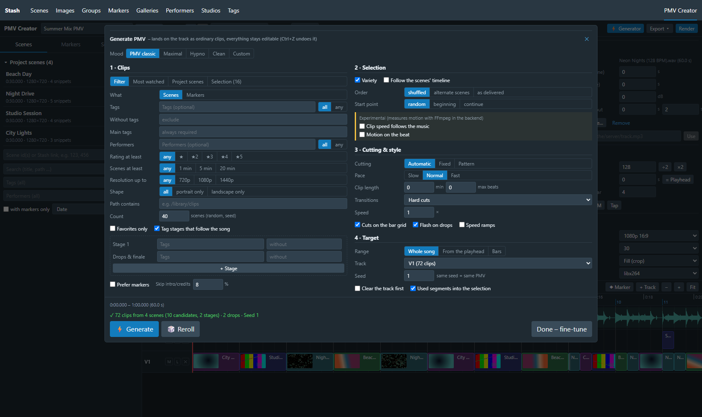
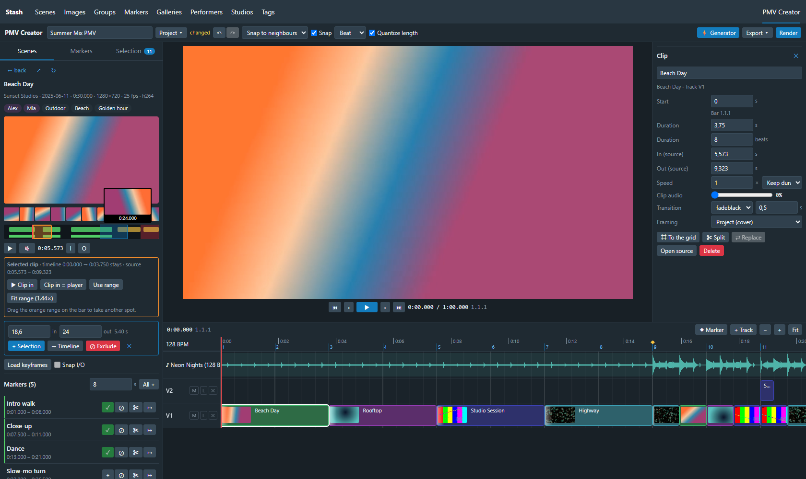

# PMV Creator – Stash plugin

Deterministic PMV (music video) editor inside [Stash](https://github.com/stashapp/stash): pick scenes and markers (culling), arrange them on a beat grid, fine-tune every clip and render frame-exactly with FFmpeg – or hand the cut to DaVinci Resolve & Co. as OTIO/EDL. Works in classic Stash and in [Stash UI](https://github.com/anonym88312/stash-pmv-plugins).

*Deutsch: [README.de.md](README.de.md)*

Architecture, data model and render pipeline: **[docs/KONZEPT.md](docs/KONZEPT.md)** (German) · project format: [schema/pmv-project.schema.json](schema/pmv-project.schema.json) · first-user test in a real Stash 0.31: [docs/TESTBERICHT.md](docs/TESTBERICHT.md) (German) · changes: [CHANGELOG.md](CHANGELOG.md)

## Installation

Requirements: Stash with the plugin UI API (`PluginApi.register.route`, `runPluginOperation`; current versions, tested with 0.31). On the Stash server Python ≥ 3.8 (*Settings → System → Python path*) and FFmpeg ≥ 4.4 – the FFmpeg Stash ships is found automatically. Marker end times are used when the server knows `end_seconds`, otherwise a configurable default length applies.

**From Stash (plugin source)** – under *Settings → Plugins → Available plugins → Sources* add

```
https://pepegasan.github.io/Stash-Folder-Sidebar-Plugin/main/index.yml
```

and install **PMV Creator** from the list (updates arrive the same way).

**Manual** – copy the folder [`plugins/pmv-creator/`](https://github.com/PepegaSan/Stash-Folder-Sidebar-Plugin/tree/main/plugins/pmv-creator) of the repository to `<stash-config>/plugins/pmv-creator/`.

**From source**

```bash
npm install
npm run build          # → dist/pmv-creator/
```

**Copy** `dist/pmv-creator/` to `<stash-config>/plugins/pmv-creator/` (no junction/symlink: Stash's plugin scanner does not follow them on Windows and the plugin simply does not appear). Then run *Settings → Plugins → Reload plugins* and reload the page. A button appears in the navbar; the page lives at `/pmv-creator`.

> Runtime data lives inside the installation: projects, segment cache and renders in `pmv-creator/data/`, uploaded music in `pmv-creator/assets/media/` (Stash serves it to the browser from there). To update, copy the folder again and leave both in place; `tests/e2e-stash/sync-plugin.ps1 -PluginsDir <stash>/plugins` does build, copy and "Reload plugins" in one step.

### Stash UI

If [Stash UI](https://github.com/anonym88312/stash-pmv-plugins) is installed, PMV Creator brings an extension module (`assets/stashui.js`, Stash UI Extension API v2) and shows up there without further setup:

- in the menu under **Watch → PMV Creator**: the editor opens as a full-screen page in Stash UI's look (colours, font); × at the top right closes it;
- in the **player's info bar** (key I): "Open in PMV Creator" takes the scene along at the current time;
- in the **selection bar of the scene list**: "PMV Creator" puts all selected scenes into the project.

Projects are the same as in the classic interface (same backend, same browser storage). The classic way (`/pmv-creator`, navbar button) stays available next to it, also with Stash UI's theme for classic Stash. Tested with Stash UI 3.95.1.

### Settings

*Settings → Plugins → PMV Creator*: FFmpeg/FFprobe path, output folder (if it lies inside a library, enable "Scan after render"), project folder, parallel jobs, clear cache.

### Language

The interface is English. It switches to German when Stash's interface language is German (*Settings → Interface → Language*) or, inside Stash UI, when Stash UI's own language is set to German; the browser language decides when neither says anything. Translations live in `src/locales/` – `npm run i18n:check` lists missing keys, and a new language is one more file.

## Workflow

1. **Music**: in the inspector (nothing selected) upload the file or enter a path on the server. Then *Detect BPM*, if needed ×2/÷2 or *Tap*, *Offset = playhead*.
2. **Culling** in the sidebar
   * *Scenes*: search and add to the project pool with **+**, or directly by **scene id / Stash link** (`123, 456` or `http://stash:9999/scenes/123`, button **+ ID**). Clicking a scene opens the drill-down. Markers: **+** (select), **⊘** (exclude), **✂** (take as a range). Ranges via **I/O** or Shift+drag on the scrub bar. *Load keyframes* shows the I-frames.
   * *Markers*: search marker tags across the library and take them in bulk.
   * *Selection*: the bin. Drag snippets onto a track, **→** inserts at the playhead, **⇄** replaces the selected clip, reorder.
3. **Arrange**: by hand or with the **⚡ Generator** (toolbar; in *Selection* with the snippets as its source). It works like a PMV generator, modelled on the Pepega PMV Generator: clips by tags (all/any/without, main tags), performers, rating, length, resolution, shape, path, favourites or "most watched", optionally as markers. Plus tag stages over the song, variety, "follow the scenes' timeline", automatic cutting by the music's energy (pace slow/normal/fast), drops with flash and speed ramps. Experimental: *clip speed follows the music* and *motion on the beat* (see [KONZEPT](docs/KONZEPT.md#generator)). The result lands on the track as ordinary clips (one undo step). The same seed gives the same PMV, 🎲 rerolls.

   
4. **Fine-tune**: click a clip, then set start, duration (s/beats), source in/out, speed, transition, clip audio and framing in the inspector. Framing (per project under *Output*, per clip in the inspector): **Fit (blurred edges)** shows the whole picture over a blurred, filled copy of itself (default, like the PMV Generator – portrait clips stay complete in a 16:9 video), **Fill (crop)** fills the frame and cuts the edges, **Fit (bars)** adds black bars.
   Ground rule: **another part of the scene never changes the clip's place on the timeline.** The clip still runs from A to B, only with other material. This holds for source in/out in the inspector, Alt+drag and ⇄ replace. It also holds in the scene view (double-click the clip or "Open source"): the clip appears there as an orange range on the bar and can be moved. There is also "Clip in = player", per marker "↦" (put the clip on this marker) and, with an I/O selection, "Use range" (speed stays) or "Fit range" (exactly this range, speed adapts). If another scene is open, "Insert from player" puts its material into the same slot. Length and position are changed on the timeline only (drag edges, move, "Duration").

   
5. **Render** (a Stash task with progress) or **Export** → OTIO / EDL / FFmpeg script / render plan / project file.
   The render dialog also offers **Quick record (browser)**: the sequence plays once in the browser and is recorded as WebM (MediaRecorder), then saved to the output folder and scanned. It takes exactly as long as the song and needs no FFmpeg on the server – handy on a weak NAS – but it is real time, not frame-exact: a stutter or a slow stream ends up in the video. The FFmpeg render is the exact one.

Edit modes (toolbar): **Snap to neighbours** (clips stop at their neighbours, default) · **Ripple** (later clips move along) · **Overwrite** (overlapped clips are trimmed/split).

### Mouse & keyboard

| Action | Input |
|---|---|
| Move / trim / slip a clip | drag · drag the edges · Alt+drag |
| Without snapping | Shift while dragging |
| Open a clip's source | double-click the clip |
| Play / pause | Space |
| Frame ± / beat ± | ← → / Shift+← → |
| Nudge the selected clip by a frame/beat | Alt+← → / Alt+Shift+← → |
| Split at the playhead · replace with the selected snippet | S · R |
| Delete · ripple delete | Del · Shift+Del |
| Timeline marker | M (double-click in the ruler removes it) |
| Undo / redo | Ctrl+Z / Ctrl+Y (Ctrl+Shift+Z) |
| Zoom | Ctrl+wheel, + / − · wheel = scroll horizontally |

Deep links: `/pmv-creator?scenes=12,34,56` puts scenes straight into the project pool, `?project=<id>` opens a project.

## Rendering without Stash (CLI)

The *Render plan (.json)* export contains everything the renderer needs:

```bash
python plugin/backend/pmv_backend.py render my-pmv.render-plan.json -o my-pmv.mp4 --jobs 4
python plugin/backend/pmv_backend.py script my-pmv.render-plan.json --shell sh > render.sh
```

## Development

```bash
npm run watch          # rebuild the bundles on change (incl. manifest/backend)
npm run typecheck
npm test               # Vitest: timeline ops, flatten/transitions, render plan, EDL/OTIO,
                       #         generator, BPM detection, UI smoke test against a mocked Stash
npm run test:backend   # Python e2e with real FFmpeg: every segment type, 30/29.97 fps (CFR),
                       #         cache, generated script, plugin interface, TS-built plan
npm run i18n:check     # keys missing from a locale
npm run release        # build + release/pmv-creator-<version>.zip + index.yml (plugin source)
```

`tests/e2e-stash/` holds the scripts for an isolated Stash test instance (`start-stash.ps1`, `sync-plugin.ps1`).

## Troubleshooting

* **No navbar button**: reload the plugins *and* reload the browser page. On the first start Stash's "release notes" dialog covers the navbar. If the plugin folder is a junction/symlink, Stash does not load it – copy instead.
* **The PMV does not appear in Stash after rendering**: Stash only scans folders inside a library. The render dialog warns when the output folder lies outside; add the folder as a library or choose a folder inside one.
* **"Backend unreachable" / saving only locally**: Python is missing or not configured in Stash (*Settings → System → Python path*). Details are in the Stash log.
* **The waveform does not load**: the music is served via `ui.assets`. Check whether `/plugin/pmv-creator/assets/media/<file>` is reachable in the browser.
* **Preview stutters / stays black**: codecs the browser cannot play (e.g. HEVC in Firefox, WMV) go through Stash transcodes, which restart on every seek. The render is not affected.

## License

[MIT](LICENSE)
